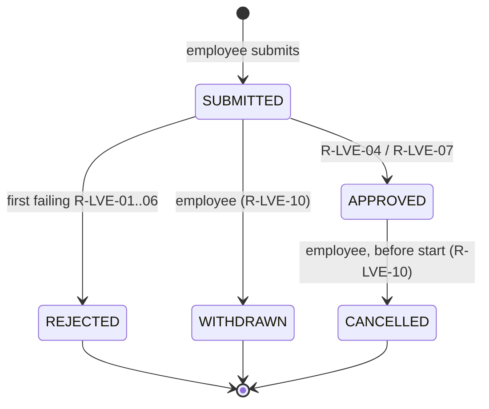
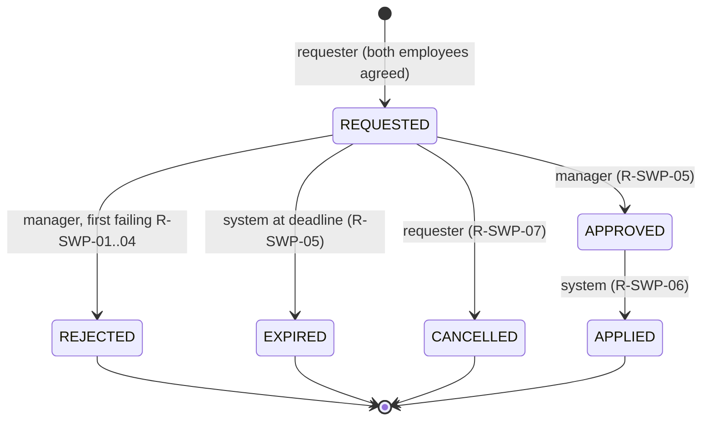
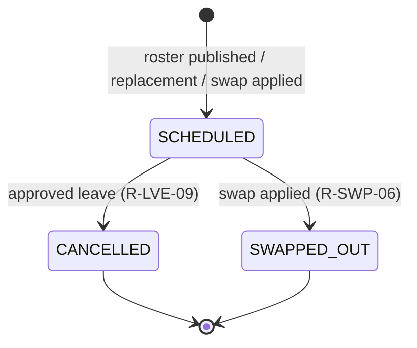

# YottaShift — Business Rules, Lifecycles and Metrics

Every generated outcome (leave decision, assignment, swap decision, attendance classification,
overtime flag, coverage gap) is produced by one of the numbered rules below and carries its rule
ID (`decision_rule_id`, event `rule_id`, ground-truth `rule_id`). Outcomes are never drawn at random.
Random draws (from the fixed seed) are used only for *inputs*: who asks for leave and when,
how late someone clocks in, how long a manager takes to respond.

The rule list is mirrored in [`src/domain/rules.js`](../src/domain/rules.js); a test fails if the
two differ. Policy thresholds live in `POLICY` in the same file; per-employment-type labour
limits live in the `labor_policy` table.

**Contents:** [1. Actors](#1-actors) · [2. Rules](#2-rules) · [3. Lifecycles](#3-lifecycles) ·
[4. Labelled anomalies](#4-labelled-anomalies-and-boundary-cases) · [5. Metrics](#5-metrics) ·
[6. Defaults](#6-policy-defaults)

---

## 1. Actors

| Actor | `actor_role` | Owns / does | Sees (Phase 9) |
| --- | --- | --- | --- |
| Employee | `EMPLOYEE` | Submits, withdraws and cancels leave; requests and cancels swaps; clocks in and out | Own schedule, leave and swap status |
| Manager | `MANAGER` | One per team (`team.manager_employee_id`). Approves or rejects leave of up to 5 days and all swaps for their team; owns the team roster | Team coverage gaps, pending approvals, exceptions |
| HR partner | `HR_PARTNER` | Employees of the Workforce Office team; each team has one (`team.hr_partner_employee_id`). Decides leave over 5 days and all unpaid leave; owns `labor_policy` and leave entitlements | Overtime cap breaches, leave balances, fairness |
| IT / operations partner | `OPS_PARTNER` | Employees of the Workforce Office team. Run the attendance devices; correct missing punches with `MANUAL` events (`attendance_event.recorded_by_employee_id`) | Attendance reconciliation exceptions |
| System administrator | — (acts through `SYSTEM`) | Maintains master data (teams, skills, templates, holiday calendar, coverage requirements); runs generation, roster publication and validation | Validation summary, reproducibility report |
| System | `SYSTEM` | Publishes rosters, auto-approves sick leave, expires swaps, applies approved swaps, records no-shows | — |

**Workforce Office.** One of the teams (`team_function = WORKFORCE_OFFICE`) is non-operational.
It holds the HR and operations partners and its own manager, has no coverage requirements, and
is never rostered. Only `MEMBER` and `LEAD` employees of operational teams are *schedulable*.

---

## 2. Rules

### 2.1 General

#### R-GEN-01
**Append-only history.** Every status change of a leave request, swap request or shift assignment
is written as a new row in its `*_event` table (`event_seq` 1, 2, 3 …). The parent row's `status`
(and decision columns) is a projection that must equal the latest event's `to_status`. Rows are
never updated in a way that loses the previous state; a swap or backfill creates a *new*
assignment that points to the one it replaces (`supersedes_assignment_id`).

#### R-GEN-02
**Deterministic, immutable IDs.** IDs follow the formats in the
[data dictionary](data-dictionary.md#2-id-conventions), are zero-padded, are assigned in a
deterministic order from the fixed seed, and are never reused or renumbered. The same ID appears
byte-identical in CSV, JSON, SQL and the database.

#### R-GEN-03
**Schema vs validator.** `sql/schema.sql` enforces structure: keys, ID formats, enums, date and
timestamp validity, and consistency inside a single row. Rules that span rows (R-SCH-01 … R-SCH-08,
R-SWP-06, R-OVT-02 …) are checked by the validator (Phase 6). This keeps deliberately injected,
labelled anomalies loadable instead of having the database silently reject them.

### 2.2 Coverage

#### R-COV-01
**Required headcount.** For shift *s*, team *t* and skill *k*, the required headcount is the
`min_headcount` of the `coverage_requirement` row with `team_id = t`,
`template_code = s.template_code`, `skill_id = k`, `day_type = s.day_type` and
`effective_from ≤ s.shift_date ≤ effective_to` (open-ended when `effective_to` is null). No
matching row means 0. Effective ranges for the same (team, template, skill, day type) never
overlap, so at most one row matches.

#### R-COV-02
**Operating pattern.** A team staffs only the templates of its pattern:

| `operating_pattern` | Templates | Days |
| --- | --- | --- |
| `TWENTY_FOUR_SEVEN` | A, B, C | every day |
| `EXTENDED_HOURS` | A, B | every day |
| `BUSINESS_HOURS` | G | weekdays only (no WEEKEND or HOLIDAY requirements) |

#### R-COV-03
**Day type.** `shift.day_type` is `HOLIDAY` if the date is in `holiday_calendar`, otherwise
`WEEKEND` on Saturday or Sunday, otherwise `WEEKDAY`. Holiday takes precedence over weekend.

#### R-COV-04
**Coverage gaps.** `qualified_headcount` counts the final `SCHEDULED` assignments for
(shift, team, skill) whose employee holds that skill validly on the date (R-SCH-03).
`gap_headcount = max(0, required − qualified)`; `status = GAP` when it is above 0. Unfillable
demand is **reported** as a gap. The scheduler never fills it with someone who lacks the skill or
would break a hard constraint. `attended_gap_headcount` repeats the calculation with the people
who actually clocked in.

### 2.3 Scheduling (hard constraints unless stated)

#### R-SCH-01
**No double booking.** An employee has at most one active (`SCHEDULED`) assignment per
`shift_date`, and no two active assignments overlap in time. Violation → `DOUBLE_BOOKED`.

#### R-SCH-02
**Leave respected.** No active assignment on a `shift_date` between `start_date` and `end_date`
of one of the employee's `APPROVED` leave requests. Leave that ends the day before a shift is valid
(boundary case). Violation → `LEAVE_OVERLAP`.

#### R-SCH-03
**Skill held.** The assignment's `skill_id` must be in `employee_skill` for that employee with
`valid_from ≤ shift_date ≤ valid_to` (open-ended when null). An expired certification counts as
absent. Violation → `SKILL_ABSENT`.

#### R-SCH-04
**Employable.** `hire_date ≤ shift_date ≤ termination_date` (open-ended when null), and the
employee's role is `MEMBER` or `LEAD`. Managers, HR partners and ops partners supervise and
approve; they do not fill coverage.

#### R-SCH-05
**Team and template.** `shift_assignment.team_id` equals the employee's `team_id`, and the
shift's template belongs to the team's operating pattern (R-COV-02).

#### R-SCH-06
**Minimum rest.** Between the end of one active assignment and the start of the employee's next
one there are at least `labor_policy.min_rest_hours` (default 11 h). Exactly 11 h is valid
(boundary case). Example: B (ends 22:00) followed by A the next day (starts 06:00) gives 8 h, so
that pair is not allowed.

#### R-SCH-07
**Consecutive days.** An employee works at most `labor_policy.max_consecutive_days` (default 6)
calendar days in a row. Exactly 6 is valid (boundary case).

#### R-SCH-08
**Weekly scheduled hours.** Per ISO week, scheduled hours ≤
`min(max_weekly_scheduled_hours, contracted_weekly_hours × employed_days / 7 + weekly_overtime_cap_hours)`,
where `employed_days` is the number of days of that week inside the window **and** inside the
employee's employment. The second term keeps planned work inside the overtime cap in the partial
first and last weeks of the window and for joiners and leavers.

#### R-SCH-09
**Fair candidate ordering (soft).** For each open slot (shift, team, skill), the scheduler only
considers employees who pass R-SCH-01 … R-SCH-08, then orders them by:
1. lowest share of contracted hours already scheduled this ISO week, compared in bands of 20 %
   of the contract (one 8-hour shift of a 40-hour contract), so that inside a band the next key
   decides;
2. fewest night (C) shifts so far if the slot is a night shift, fewest weekend shifts if it is a
   weekend, fewest holiday shifts if it is a holiday;
3. lowest total scheduled hours in the window so far, relative to contracted hours;
4. a seeded tie-break.

This spreads hours, nights, weekends and holidays evenly. Fairness is measured by M-08. Within a
team and date, skills with the fewest qualified people are filled first, so multi-skilled staff
are not used up on slots others could fill.

#### R-SCH-10
**Weekly publication.** The roster for ISO week *w* is built and published at 18:00 on the day
7 days before the week starts (`shift_assignment.created_at`). It takes into account leave that
is `APPROVED` at publication time. Leave approved later is handled by R-LVE-09.

### 2.4 Leave

#### R-LVE-01
**Order and eligibility.** Leave is requested by schedulable employees. Requests are decided in
`decided_at` order (ties: `submitted_at`, then generation order), so balance and team-cap
checks see exactly the decisions made before this one; an approved leave cancelled before this
decision no longer counts.
Rules R-LVE-01 … R-LVE-07 are evaluated in number order: the first failing check rejects the
request, and R-LVE-04 approves SICK leave without the later checks. An employee who is not
employed on every requested date (R-SCH-04 dates) → `REJECTED`, `EMPLOYEE_NOT_ACTIVE`.

#### R-LVE-02
**No overlapping requests.** A request overlapping one of the employee's own requests that is,
at this decision, either approved (and not cancelled) or still awaiting its decision (submitted
earlier, not yet decided or withdrawn) → `REJECTED`, `OVERLAPS_EXISTING_LEAVE`.

#### R-LVE-03
**Balance.** For ANNUAL, CASUAL and SICK leave:
`entitled_days − approved days so far ≥ requested_days`, otherwise `REJECTED`,
`INSUFFICIENT_BALANCE`. UNPAID leave has no balance. Leave days are calendar days, inclusive
(`requested_days = end_date − start_date + 1`); shift work has no fixed weekend.

#### R-LVE-04
**Sick leave.** SICK leave that passes R-LVE-01 … R-LVE-03 is `APPROVED` immediately by `SYSTEM`
(`SICK_AUTO_APPROVED`), with no notice or team-cap check. Sick call-ins are submitted on the day,
a few hours before the shift.

#### R-LVE-05
**Notice.** `start_date − date(submitted_at)` must be at least the notice for the type
(ANNUAL 7 days, CASUAL 1 day, UNPAID 14 days), otherwise `REJECTED`, `INSUFFICIENT_NOTICE`.

#### R-LVE-06
**Team leave cap.** On every requested date, the number of team members already on approved
leave, plus this request, must not exceed `max(1, floor(0.15 × schedulable team headcount))`.
Otherwise `REJECTED`, `TEAM_LEAVE_CAP_REACHED`. Headcount counts the team's `MEMBER` and `LEAD`
employees who are employed on that date. Sick leave approved under R-LVE-04 counts towards the
total but is never blocked by it.

#### R-LVE-07
**Approval.** A request that passes every check is `APPROVED`, `APPROVED_WITHIN_POLICY`. It is
decided by the team's HR partner (`HR_PARTNER`, `team.hr_partner_employee_id`) when
`requested_days > 5` or the type is UNPAID, otherwise by the team manager
(`team.manager_employee_id`). Rejections under R-LVE-01 … R-LVE-06 are recorded under the same
decider.

#### R-LVE-08
**Decision timing.** Manager and HR decisions take 1–48 h after submission (seeded response
time), capped at one minute before the leave starts. SICK decisions are made at submission.
Discretionary leave is submitted 1–45 days ahead (some deliberately inside the notice period);
sick call-ins arrive between 03:00 and 05:30 on the first sick day, before any shift starts.

#### R-LVE-09
**Late approval.** When leave is approved after the affected week's roster was published, every
overlapping `SCHEDULED` assignment gets a `CANCELLED` event (`LEAVE_APPROVED`, with the
`leave_request_id`) at the decision time. For each cancelled slot the scheduler looks for a
replacement under R-SCH-01 … R-SCH-09 (`source = REPLACEMENT`, `REPLACEMENT_FOR_LEAVE`,
`supersedes_assignment_id` = the cancelled one). Shifts starting within 30 minutes of the
decision are not backfilled. If nobody qualifies, the slot becomes a coverage gap (R-COV-04).
A leave approved *before* a week is published simply keeps the employee off that week's roster.

#### R-LVE-10
**Withdrawal and cancellation.** The employee may withdraw a `SUBMITTED` request (`WITHDRAWN`,
`EMPLOYEE_WITHDREW`) or cancel an `APPROVED` one before it starts (`CANCELLED`,
`EMPLOYEE_CANCELLED`). Cancelling gives the days back to the balance. Assignments already
cancelled for that leave are **not** restored; their history stays as it is.

### 2.5 Swaps

#### R-SWP-01
**Same team.** Requester, counterpart and both assignments belong to the same team. Otherwise
`REJECTED`, `NOT_SAME_TEAM`.

#### R-SWP-02
**Qualification.** The counterpart holds, validly on that date, the skill of the requester's
assignment. For `SWAP` type, the requester also holds the skill of the counterpart's assignment.
Otherwise `REJECTED`, `SKILL_NOT_HELD`.

#### R-SWP-03
**Still feasible.** First, both assignments must still be `SCHEDULED` at the decision (a leave
approval may have cancelled one meanwhile) → otherwise `ASSIGNMENT_CHANGED`. Then, after the
exchange, both employees still satisfy R-SCH-01, 02, 04, 06, 07 and 08, using the roster and the
approved leave as they stand at the decision time. The first failing rule gives the reason:
`DOUBLE_BOOKING`, `ON_APPROVED_LEAVE`,
`EMPLOYEE_NOT_ACTIVE`, `REST_RULE_BREACH`, `CONSECUTIVE_DAYS_BREACH`, `WEEKLY_HOURS_BREACH`.
`COVER` swaps (the counterpart takes the shift, nothing comes back) are checked for the
counterpart only.

#### R-SWP-04
**Notice.** `requested_at` is at least 24 h before the start of the earliest affected shift.
Otherwise `REJECTED`, `INSUFFICIENT_NOTICE`.

#### R-SWP-05
**Decision or expiry.** The team manager decides by evaluating R-SWP-01 … R-SWP-04 in order:
all pass → `APPROVED`, `APPROVED_WITHIN_POLICY`; else `REJECTED` with the first failing reason.
The manager's seeded response time decides *when*. If it falls after the deadline,
`min(requested_at + 48 h, earliest shift start)`, the request becomes `EXPIRED`
(`SYSTEM`, `NO_DECISION_BEFORE_DEADLINE`) at the deadline instead. While a request is open its
assignments are locked: no second swap request can target them. Requests are made by members
against shifts 2 h to 14 days ahead; the requester usually (configurable) asks a colleague who
holds the skill and is free and rested for the shift, so most rejections come from the cases
where they did not.

#### R-SWP-06
**Apply only after approval.** Only an `APPROVED` swap becomes `APPLIED`, within 10 minutes of
approval and before the shift starts. Applying it writes `SWAPPED_OUT` events on the original
assignments and creates new assignments (`source = SWAP`, `swap_id`,
`supersedes_assignment_id`). A swap that is `APPLIED`, or has a `SWAP`-source assignment, without
an `APPROVED` event in its history → `SWAP_WITHOUT_APPROVAL`.

#### R-SWP-07
**Requester cancellation.** The requester may cancel while the request is `REQUESTED`
(`CANCELLED`, `REQUESTER_CANCELLED`).

#### R-SWP-08
**Swap history preserved.** For every swap, its event chain starts at `REQUESTED`, follows only
allowed transitions (§3), ends at the row's current status, and every assignment it created or
replaced is reachable through `swap_id` / `supersedes_assignment_id`. Nothing is deleted.

### 2.6 Attendance

#### R-ATT-01
**Completeness.** Every final `SCHEDULED` assignment whose shift ended before the snapshot has
either one `CLOCK_IN` and one `CLOCK_OUT`, or one `NO_SHOW`. `CANCELLED` and `SWAPPED_OUT`
assignments have no attendance events. Outcome in `attendance_reconciliation`: `PRESENT`,
`NO_SHOW`, `MISSING_PUNCH` (clock-in only) or `NO_RECORD` (nothing at all, a data error).

#### R-ATT-02
**Classification.** Measured against the shift's `start_at` / `end_at`:
`late_minutes = max(0, clock_in − start)`, flagged late above 5 minutes of grace;
`early_leave_minutes = max(0, end − clock_out)`, flagged above 5 minutes;
`extension_minutes = max(0, clock_out − end)`, counted as an extension above 15 minutes.
A clock-in more than 60 minutes before the start is not expected.

#### R-ATT-03
**Worked time.** `worked_minutes = clock_out − max(clock_in, shift start)`. Arriving early is not
paid; staying late is. Worked hours are attributed to the ISO week of the `shift_date`, so a
night shift crossing Sunday midnight counts in the week it started.

#### R-ATT-04
**Missing punch.** A clock-in with no device clock-out is corrected by an ops partner with a
`MANUAL` `CLOCK_OUT` whose `recorded_at` is later than its `event_at` and whose
`recorded_by_employee_id` names that ops partner. Uncorrected →
`MISSING_PUNCH` in the reconciliation.

#### R-ATT-05
**No-show.** When an employee never clocks in, `SYSTEM` records a `NO_SHOW` event at the shift's
end. Approved sick call-ins do not produce no-shows, because the approval cancels the assignment
first (R-LVE-04, R-LVE-09). A sick call-in that was **rejected** (e.g. no sick balance left) still
keeps the employee at home, so their shifts in that period become no-shows.

### 2.7 Overtime

#### R-OVT-01
**Weekly overtime.** Per employee per ISO week:
`overtime_hours = max(0, worked_hours − contracted_weekly_hours × employed_days / 7)`, rounded
to 2 decimals, with `employed_days` as in R-SCH-08 (7 except in the partial first and last weeks —
2026-W01 = 4 days, 2026-W14 = 2 days in the full profile — and for joiners and leavers).
Worked hours come only from complete punch pairs (R-ATT-03).

#### R-OVT-02
**Overtime cap.** `overtime_hours ≤ weekly_overtime_cap_hours` (FT 12 h, PT 8 h). Strictly above
→ `is_overtime_cap_exceeded = 1`, `OVERTIME_CAP_EXCEEDED`. Exactly at the cap is valid
(boundary case). The generator keeps the clean baseline inside the cap by never letting a
clock-out use time the rest of the week's shifts still need.

---

## 3. Lifecycles

Allowed transitions are encoded in `TRANSITIONS` in
[`src/domain/constants.js`](../src/domain/constants.js) and checked by the validator against every
event chain.

### Leave request

### Swap request

### Shift assignment

Attendance outcome is **not** an assignment status. It is derived in `attendance_reconciliation`,
so the roster and what actually happened stay separate and can be reconciled.

### Employee

`ACTIVE` from `hire_date`; `TERMINATED` once a `termination_date` inside the window has passed.
Employment is effective-dated, so it has no event table.

---

## 4. Labelled anomalies and boundary cases

Injected by [`src/generator/anomalies/inject.js`](../src/generator/anomalies/inject.js) **after**
the valid baseline is complete (Phase 5); the derived tables are then recomputed from the final
records. Each case is listed in `data/<profile>/ground_truth/ground_truth.csv` (and `.json`) with
the rule it breaks. Nothing in the input tables marks it.

Each anomaly is built to break **only its own rule**, to touch only the rows it names, and to stay
structurally valid (schema, FKs, IDs). Each employee is used by at most one label, so cases never
interact.

| `issue_type` | Class | Rule | How it is made | Rows touched | Expected detection |
| --- | --- | --- | --- | --- | --- |
| `DOUBLE_BOOKED` | ANOMALY | R-SCH-01 | A second booking of a shift the employee already works (another held skill if possible), with a `NO_SHOW` on it — they cannot be in two places. The same shift keeps rest and consecutive days unchanged; only weeks with room under R-SCH-08 are used | 1 new assignment + its event + 1 attendance event | flagged |
| `LEAVE_OVERLAP` | ANOMALY | R-SCH-02 | A shift added inside an existing approved leave (fits every other roster rule), with a `NO_SHOW`. The leave itself is untouched, so no later leave decision changes | 1 new assignment + its event + 1 attendance event | flagged |
| `SKILL_ABSENT` | ANOMALY | R-SCH-03 | A worked assignment switched to a skill its team requires but the employee does not hold | 1 assignment | flagged |
| `OVERTIME_CAP_EXCEEDED` | ANOMALY | R-OVT-02 | In a full week where every shift was worked, the last clock-out moved later by the remaining budget + 15–90 min | 1 attendance event (new ID, since the ID contains the time) | flagged |
| `SWAP_WITHOUT_APPROVAL` | ANOMALY | R-SWP-06 | The `APPROVED` event removed from an applied swap and the decision columns cleared; the chain becomes `REQUESTED → APPLIED`, so R-SWP-08 also fires on the same swap (expected) | 1 swap + its events | flagged |
| `BOUNDARY_OVERTIME_AT_CAP` | BOUNDARY | R-OVT-02 | In a full week, the last clock-out moved so worked time equals contract + cap exactly | 1 attendance event | not flagged |
| `BOUNDARY_LEAVE_ADJACENT_SHIFT` | BOUNDARY | R-SCH-02 | Found in the data: approved leave ending the day before an assigned shift | none | not flagged |
| `BOUNDARY_CONSECUTIVE_DAYS_AT_MAX` | BOUNDARY | R-SCH-07 | Found in the data: exactly `max_consecutive_days` working days in a row | none | not flagged |
| `BOUNDARY_SWAP_AT_NOTICE_LIMIT` | BOUNDARY | R-SWP-04 | An applied swap whose decision came within 24 h of the shift gets `requested_at` = shift start − 24 h exactly | 1 swap + its first event | not flagged |
| `BOUNDARY_REST_AT_MINIMUM` | BOUNDARY | R-SCH-06 | **Not producible:** no two templates of one operating pattern are exactly 11 h apart (A/B/C give 8 h or 16 h, G gives 16 h). Covered by a scheduler unit test (B → G across patterns) | — | not flagged |

Volumes: `anomaliesPerType` and `boundaryCasesPerType` per profile (starter 3 / 2, full 20 / 10).
Boundary cases are found in, or nudged from, real records, so a small profile may have fewer
(the starter has no swap decided within 24 h of its shift).

Boundary labels test the detectors for false positives. A good detector flags every ANOMALY row
and none of the BOUNDARY rows. A finding **matches** a label when it has the same `issue_type`
and shares at least one record ID with the label's `record_ids`.

---

## 5. Metrics

Computed from the tables (Phase 4) by `src/derive/metrics.js` and written to
`data/<profile>/reports/metrics.json` (with a readable `metrics.md`). Fairness (M-08) uses
schedulable members employed for the whole window, compared within their team, so joiners and
leavers do not distort it.

| ID | Metric | Definition |
| --- | --- | --- |
| M-01 | Coverage fill rate | Σ min(qualified, required) / Σ required over all (shift, team, skill); also with attended in place of qualified (after absences) |
| M-02 | Gap volume | Count of `GAP` rows and Σ gap_headcount × shift hours, by team, skill, template, day type |
| M-03 | Overtime | Total overtime hours, p50 / p90 / max per employee-week with overtime, count of employee-weeks above the cap, scheduled ÷ contracted hours |
| M-04 | Leave outcomes | Approval rate by leave type; rejections by reason code; share decided by HR |
| M-05 | Swap outcomes | Counts by status and type; approval rate of manager decisions; expiry rate; rejections by reason; manager response time p50 / p90 |
| M-06 | Attendance quality | Outcomes; punctuality, late (> 5 min), early-leave (> 5 min), extension (> 15 min), no-show, missing-punch and manual-correction rates |
| M-07 | Reconciliation | Share of due assignments with a complete record (punch pair or no-show); scheduled vs worked hours, overall and by operating pattern |
| M-08 | Fairness | Per team: coefficient of variation of scheduled hours ÷ contracted hours, and Jain's index `(Σx)² / (n·Σx²)` for night, weekend and holiday shift counts across schedulable members (1.0 = perfectly even) |
| M-09 | Detection quality | Precision and recall per `issue_type` of the detectors against the ground truth, boundary cases flagged, confusion table, unexplained findings — written by `npm run validate` to `validation_summary.{json,md}` |

---

## 6. Policy defaults

| Setting | Value | Where |
| --- | --- | --- |
| Full-time contract / max scheduled / overtime cap | 40 h / 48 h / 12 h per week | `labor_policy` `POL-FT-2026` |
| Part-time contract / max scheduled / overtime cap | 24 h / 32 h / 8 h per week | `labor_policy` `POL-PT-2026` |
| Minimum rest; max consecutive days | 11 h; 6 days | `labor_policy` |
| Late / early-leave grace; extension threshold; earliest clock-in | 5 min; 5 min; 15 min; 60 min | `POLICY.attendance` |
| Notice: annual / casual / unpaid | 7 / 1 / 14 days | `POLICY.leave` |
| Team leave cap; HR approval above | 15 % of schedulable headcount (min 1); 5 days | `POLICY.leave` |
| Swap notice; decision deadline; apply within | 24 h; 48 h; 10 min | `POLICY.swap` |
| Roster publication | 18:00, 7 days before the ISO week | `POLICY.roster` |
