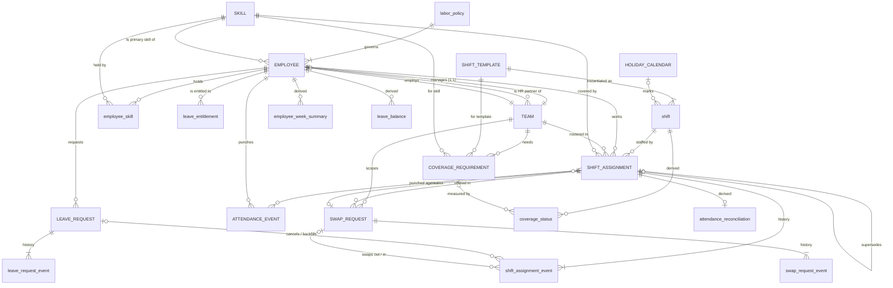

# YottaShift — Entity Relationships

Primary keys, foreign keys and cardinality for every table in [`sql/schema.sql`](../sql/schema.sql).
Field details are in the [data dictionary](data-dictionary.md).

## 1. Diagram

Core entities named in the brief are in capitals; supporting tables in lower case.

The diagram leaves out the "who acted" links (`actor_employee_id`, `decided_by_employee_id`,
`recorded_by_employee_id`), which all point to `EMPLOYEE` and are optional. They are listed in §2.

## 2. Relationships and cardinality

`1` = exactly one, `0..1` = optional, `1..N` = at least one, `0..N` = any number. **Optional**
means the FK column is nullable.

| # | Child (FK column) | Parent | Cardinality (parent : child) | Optional? | Notes |
| --- | --- | --- | --- | --- | --- |
| 1 | `employee.team_id` | `team` | 1 : 1..N | No | One team for the whole window |
| 2 | `team.manager_employee_id` | `employee` | 1 : 1 | No | `UNIQUE`; deferred FK because team and employee point at each other |
| 3 | `team.hr_partner_employee_id` | `employee` | 1 : 0..N | No | One HR partner looks after several teams; deferred FK |
| 4 | `employee.policy_id` | `labor_policy` | 1 : 0..N | No | By employment type |
| 5 | `employee.primary_skill_id` | `skill` | 1 : 0..N | No | Must also be in `employee_skill` |
| 6 | `employee_skill.employee_id` / `.skill_id` | `employee` / `skill` | **N : M** via bridge | No | PK (`employee_id`, `skill_id`); effective-dated by `valid_from` / `valid_to` |
| 7 | `leave_entitlement.employee_id` | `employee` | 1 : 0..3 | No | One per entitled leave type per period |
| 8 | `shift.template_code` | `shift_template` | 1 : 0..N | No | One shift per date × template |
| 9 | `shift.holiday_id` | `holiday_calendar` | 0..1 : 0..N | **Yes** | Set only on holiday dates (all four templates) |
| 10 | `coverage_requirement.team_id` / `.template_code` / `.skill_id` | `team` / `shift_template` / `skill` | 1 : 0..N each | No | Associative entity for the Team × ShiftTemplate × Skill demand (an **N:M:M** relationship with attributes); effective-dated |
| 11 | `shift_assignment.shift_id` | `shift` | 1 : 0..N | No | Assignment is the associative entity for **Employee N:M Shift**, with its own lifecycle |
| 12 | `shift_assignment.employee_id` | `employee` | 1 : 0..N | No | — |
| 13 | `shift_assignment.team_id` | `team` | 1 : 0..N | No | Must equal the employee's team (R-SCH-05) |
| 14 | `shift_assignment.skill_id` | `skill` | 1 : 0..N | No | Skill covered on that shift |
| 15 | `shift_assignment.swap_id` | `swap_request` | 0..1 : 0..2 | **Yes** | Set only for `source = SWAP`; a SWAP creates 2 assignments, a COVER creates 1. Deferred FK (swap and assignments reference each other) |
| 16 | `shift_assignment.supersedes_assignment_id` | `shift_assignment` | 0..1 : 0..1 | **Yes** | Null only for `ROSTER`; each assignment is replaced at most once (validator) |
| 17 | `shift_assignment_event.assignment_id` | `shift_assignment` | 1 : 1..N | No | Append-only history |
| 18 | `shift_assignment_event.leave_request_id` | `leave_request` | 0..1 : 0..N | **Yes** | Leave that caused a cancellation or replacement |
| 19 | `shift_assignment_event.swap_id` | `swap_request` | 0..1 : 0..N | **Yes** | Swap that caused a swap-out or swap-in |
| 20 | `leave_request.employee_id` | `employee` | 1 : 0..N | No | — |
| 21 | `leave_request_event.leave_request_id` | `leave_request` | 1 : 1..N | No | Append-only history |
| 22 | `attendance_event.assignment_id` | `shift_assignment` | 1 : 0..2 | No | 2 punches, or 1 no-show, per due assignment |
| 23 | `attendance_event.employee_id` | `employee` | 1 : 0..N | No | Equals the assignment's employee |
| 24 | `swap_request.team_id` | `team` | 1 : 0..N | No | — |
| 25 | `swap_request.requester_employee_id` / `.counterpart_employee_id` | `employee` | 1 : 0..N each | No | Different people |
| 26 | `swap_request.requester_assignment_id` | `shift_assignment` | 1 : 0..N | No | Several requests may target the same shift over time |
| 27 | `swap_request.counterpart_assignment_id` | `shift_assignment` | 0..1 : 0..N | **Yes** | Set only for `SWAP` |
| 28 | `swap_request_event.swap_id` | `swap_request` | 1 : 1..N | No | Append-only history |
| 29 | `*_event.actor_employee_id`, `*.decided_by_employee_id` | `employee` | 0..1 : 0..N | **Yes** | Null when the actor is `SYSTEM` |
| 30 | `attendance_event.recorded_by_employee_id` | `employee` | 0..1 : 0..N | **Yes** | Set only for `MANUAL` corrections |
| 31 | `employee_week_summary.employee_id` | `employee` | 1 : 0..N | No | Derived; one per ISO week |
| 32 | `coverage_status.shift_id` / `.team_id` / `.skill_id` | `shift` / `team` / `skill` | 1 : 0..N each | No | Derived |
| 33 | `coverage_status.coverage_id` | `coverage_requirement` | 0..1 : 0..N | **Yes** | Null when nothing is required |
| 34 | `leave_balance.employee_id` | `employee` | 1 : 0..3 | No | Derived |
| 35 | `attendance_reconciliation.assignment_id` (+ `.employee_id`, `.shift_id`) | `shift_assignment` (+ `employee`, `shift`) | 1 : 0..1 | No | Derived; PK = FK to the assignment |

## 3. Many-to-many relationships

| Relationship | Resolved by | Extra attributes |
| --- | --- | --- |
| Employee ↔ Skill | `employee_skill` (bridge) | proficiency, validity dates |
| Employee ↔ Shift | `shift_assignment` | team, skill covered, source, status, history |
| Team ↔ ShiftTemplate ↔ Skill | `coverage_requirement` | day type, minimum headcount, effective dates |

## 4. Effective dates

| Table | Columns | Meaning |
| --- | --- | --- |
| `labor_policy` | `effective_from` / `effective_to` | Period the limits apply |
| `team` | `effective_from` / `effective_to` | Team existence |
| `employee` | `hire_date` / `termination_date` | Employment period; drives R-SCH-04 and R-LVE-01 |
| `employee_skill` | `valid_from` / `valid_to` | Skill or certification validity; drives R-SCH-03 |
| `shift_template` | `effective_from` / `effective_to` | Template in use |
| `coverage_requirement` | `effective_from` / `effective_to` | Demand level; mid-window revisions start a new row instead of editing the old one |
| `leave_entitlement` | `period_start` / `period_end` | Entitlement period |

## 5. Lifecycle states

| Entity | States | History table |
| --- | --- | --- |
| LeaveRequest | `SUBMITTED` → `APPROVED` / `REJECTED` / `WITHDRAWN`; `APPROVED` → `CANCELLED` | `leave_request_event` |
| SwapRequest | `REQUESTED` → `APPROVED` / `REJECTED` / `CANCELLED` / `EXPIRED`; `APPROVED` → `APPLIED` | `swap_request_event` |
| ShiftAssignment | `SCHEDULED` → `CANCELLED` / `SWAPPED_OUT` | `shift_assignment_event` |
| Employee | `ACTIVE` → `TERMINATED` | effective-dated (`termination_date`) |

State diagrams and the rule behind each transition: [business-rules.md §3](business-rules.md#3-lifecycles).
